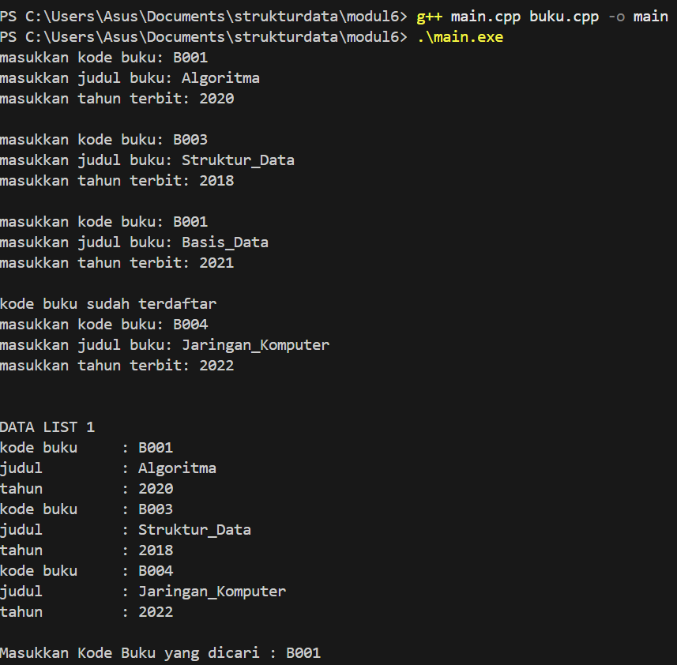
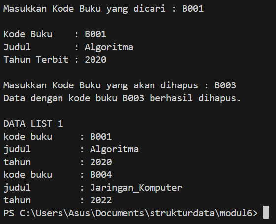

# <h1 align="center">Laporan Praktikum Modul 6 - </h1>
<p align="center">Daffa Arief Wicaksono- 109082500192</p>
## Dasar Teori

### A. Doubly Linked List

Doubly Linked List merupakan struktur data linear yang tersusun dari beberapa elemen atau node. Setiap node menyimpan data dan dua pointer, yaitu `next` yang mengarah ke node selanjutnya dan `prev` yang mengarah ke node sebelumnya. Dengan adanya kedua pointer tersebut, proses penelusuran data dapat dilakukan dari depan ke belakang maupun sebaliknya [1].

#### 1. Struktur Elemen pada Doubly Linked List

Setiap node memiliki informasi yang disesuaikan dengan data yang digunakan dalam praktikum. Pada bagian Guided, data kendaraan terdiri dari `nopol`, `warna`, dan `thnBuat`. Sementara itu, pada bagian Unguided, data buku terdiri dari `kodeBuku`, `judul`, dan `thnTerbit`. Kedua jenis data tersebut menggunakan pointer `next` dan `prev` untuk menghubungkan setiap node, serta `First` dan `Last` sebagai penanda elemen pertama dan terakhir. Jika list belum memiliki data, kedua penunjuk tersebut bernilai `nullptr` atau `Nil`.

#### 2. Pointer dan Alokasi Memori

Pointer merupakan variabel yang digunakan untuk menyimpan alamat memori suatu objek. Dalam Doubly Linked List, pointer berperan sebagai penghubung antar-node sehingga data tidak harus disimpan secara berurutan di memori. Fungsi `alokasi()` digunakan untuk membuat node baru menggunakan `new`, mengisi data, serta mengatur pointer `next` dan `prev` dengan nilai `nullptr`. Sementara itu, fungsi `dealokasi()` menggunakan `delete` untuk melepaskan memori dari node yang sudah tidak diperlukan [2][3].

#### 3. Penambahan Elemen di Akhir List

Fungsi `insertLast()` digunakan untuk menambahkan node baru pada posisi paling akhir. Apabila list masih kosong, node tersebut akan menjadi elemen pertama sekaligus terakhir. Namun, jika list sudah berisi data, node terakhir akan dihubungkan dengan node baru melalui pointer `next`, sedangkan pointer `prev` pada node baru diarahkan ke node sebelumnya. Selanjutnya, posisi `Last` diperbarui agar menunjuk ke node yang baru ditambahkan.

### B. Operasi pada Doubly Linked List

#### 1. Searching atau Pencarian Elemen

Searching merupakan proses menemukan data tertentu dengan memeriksa setiap node dalam list. Fungsi `findElm()` melakukan pencarian mulai dari node pertama (`First`), kemudian mencocokkan nilai `kodeBuku` dengan data yang dicari. Apabila ditemukan, fungsi akan mengembalikan alamat node tersebut. Jika tidak ditemukan, fungsi mengembalikan nilai `nullptr`.

#### 2. Penghapusan Elemen

Operasi penghapusan dilakukan dengan mengatur kembali hubungan pointer agar node yang dihapus tidak lagi terhubung dengan list. Fungsi `deleteFirst()` digunakan untuk menghapus node pertama dan memperbarui posisi `First`. Fungsi `deleteLast()` menghapus node terakhir dengan memperbarui `Last`, sedangkan `deleteAfter()` berfungsi menghapus node yang berada tepat setelah node `Prec`. Dalam proses ini, hubungan antara pointer `next` dan `prev` harus diperhatikan agar susunan list tetap terhubung dengan baik, termasuk ketika list hanya memiliki satu node [1].

#### 3. Implementasi ADT dengan C++

Pembuatan program Doubly Linked List dibagi menjadi tiga file, yaitu `Buku.h` sebagai tempat deklarasi tipe data dan fungsi, `Buku.cpp` untuk menuliskan implementasi setiap fungsi, serta `main.cpp` sebagai program utama untuk menjalankan dan menguji seluruh operasi. Pemisahan file tersebut membuat kode lebih terstruktur dan mudah dikelola. Selain itu, program dilengkapi pengecekan kode buku sebelum proses penambahan dilakukan untuk mencegah adanya data dengan kode yang sama sesuai ketentuan praktikum.

## Guided

### 1. Doublylist.h

```cpp
#ifndef DOUBLYLIST_H
#define DOUBLYLIST_H

#include <iostream>
#include <string>

#define Nil NULL

// Latihan 1
struct infotype {
    std::string nopol;
    std::string warna;
    int thnBuat;
};
typedef struct elmlist *address;
struct elmlist {
    infotype info;
    address next;
    address prev;
};
struct List {
    address First;
    address Last;
};

// Latihan 1
void CreateList(List &L);
address alokasi(infotype x);
void dealokasi(address &P);
void printInfo(List L);
void insertLast(List &L, address P);

// Latihan 2
address findElm(List L, std::string nopol);

// Latihan 3
void deleteFirst(List &L, address &P);
void deleteLast(List &L, address &P);
void deleteAfter(List &L, address Prec, address &P);
void deleteElm(List &L, std::string nopol, bool &status);

#endif
```

File `Doublylist.h` berisi deklarasi struktur data dan fungsi yang digunakan dalam program. `infotype` menyimpan nomor polisi, warna, dan tahun pembuatan kendaraan. Setiap elemen memiliki pointer `next` dan `prev`, sedangkan `First` dan `Last` menunjuk elemen pertama dan terakhir dalam list.

### 2. Doublylist.cpp

```cpp
#include "Doublylist.h"

// Latihan 1
void CreateList(List &L) {
    L.First = Nil;
    L.Last = Nil;
}

address alokasi(infotype x) {
    address P = new elmlist;
    P->info = x;
    P->next = Nil;
    P->prev = Nil;
    return P;
}

void dealokasi(address &P) {
    delete P;
}

void printInfo(List L) {
    address P = L.Last;
    if (P == Nil) {
        std::cout << "List kosong." << std::endl;
        return;
    }
    while (P != Nil) {
        std::cout << "no polisi : " << P->info.nopol << std::endl;
        std::cout << "warna     : " << P->info.warna << std::endl;
        std::cout << "tahun     : " << P->info.thnBuat << std::endl;
        P = P->prev;
    }
}

void insertLast(List &L, address P) {
    if (L.First == Nil) {
        L.First = P;
        L.Last = P;
    } else {
        P->prev = L.Last;
        (L.Last)->next = P;
        L.Last = P;
    }
}

// Latihan 2
address findElm(List L, std::string nopol) {
    address P = L.First;
    while (P != Nil) {
        if (P->info.nopol == nopol) {
            return P;
        }
        P = P->next;
    }
    return Nil;
}

// Latihan 3
void deleteFirst(List &L, address &P) {
    if (L.First == Nil) return;

    P = L.First;
    if (L.First == L.Last) {
        L.First = Nil;
        L.Last = Nil;
    } else {
        L.First = P->next;
        (L.First)->prev = Nil;
        P->next = Nil;
    }
}

void deleteLast(List &L, address &P) {
    if (L.First == Nil) return;

    P = L.Last;
    if (L.First == L.Last) {
        L.First = Nil;
        L.Last = Nil;
    } else {
        L.Last = P->prev;
        (L.Last)->next = Nil;
        P->prev = Nil;
    }
}

void deleteAfter(List &L, address Prec, address &P) {
    if (Prec == Nil || Prec->next == Nil) return;

    P = Prec->next;
    if (P == L.Last) {
        deleteLast(L, P);
    } else {
        Prec->next = P->next;
        (P->next)->prev = Prec;
        P->next = Nil;
        P->prev = Nil;
    }
}

void deleteElm(List &L, std::string nopol, bool &status) {
    address P = findElm(L, nopol);
    status = false;

    if (P != Nil) {
        if (P == L.First) {
            deleteFirst(L, P);
        } else if (P == L.Last) {
            deleteLast(L, P);
        } else {
            address Prec = P->prev;
            deleteAfter(L, Prec, P);
        }
        dealokasi(P);
        status = true;
    }
}
```

File `Doublylist.cpp` berisi implementasi operasi Doubly Linked List. `CreateList()` menginisialisasi list kosong, `alokasi()` membuat node baru, dan `insertLast()` menambahkan kendaraan di akhir list. `printInfo()` menampilkan data dari `Last` ke arah `First`. Fungsi `findElm()` mencari kendaraan berdasarkan nomor polisi, sedangkan fungsi `deleteFirst()`, `deleteLast()`, `deleteAfter()`, dan `deleteElm()` menangani penghapusan elemen.

### 3. main.cpp

```cpp
#include <iostream>
#include "Doublylist.h"
using namespace std;

void inputData(List &L) {
    infotype data;
    address P;

    cout << "masukkan nomor polisi: "; cin >> data.nopol;
    cout << "masukkan warna kendaraan: "; cin >> data.warna;
    cout << "masukkan tahun kendaraan: "; cin >> data.thnBuat;

    cout << endl;

    if (findElm(L, data.nopol) == Nil) {
        P = alokasi(data);
        insertLast(L, P);
    } else {
        cout << "nomor polisi sudah terdaftar" << endl;
    }
}

int main() {
    List L;
    CreateList(L);
    address P;

    // Latihan 1
    inputData(L);
    inputData(L);
    inputData(L);
    inputData(L);

    cout << "\nDATA LIST 1" << endl;
    printInfo(L);

    // Latihan 2
    string nopolCari;
    cout << "\nMasukkan Nomor Polisi yang dicari : ";
    cin >> nopolCari;

    P = findElm(L, nopolCari);
    if (P != Nil) {
        cout << "Nomor Polisi : " << P->info.nopol << endl;
        cout << "Warna        : " << P->info.warna << endl;
        cout << "Tahun        : " << P->info.thnBuat << endl;
    } else {
        cout << "Data dengan nomor polisi " << nopolCari << " tidak ditemukan." << endl;
    }

    // Latihan 3
    string nopolHapus;
    bool hapusBerhasil;

    cout << "\nMasukkan Nomor Polisi yang akan dihapus : ";
    cin >> nopolHapus;

    deleteElm(L, nopolHapus, hapusBerhasil);

    if (hapusBerhasil) {
        cout << "Data dengan nomor polisi " << nopolHapus << " berhasil dihapus." << endl;
    } else {
        cout << "Data dengan nomor polisi " << nopolHapus << " tidak ditemukan." << endl;
    }

    cout << "\nDATA LIST 1" << endl;
    printInfo(L);

    return 0;
}
```

File `main.cpp` menjadi program utama untuk menerima empat data kendaraan. Sebelum data ditambahkan, program mengecek apakah nomor polisi sudah ada agar tidak terjadi duplikasi. Setelah itu, program menampilkan isi list, mencari kendaraan berdasarkan nomor polisi, dan menghapus kendaraan berdasarkan nomor polisi yang dimasukkan pengguna.


---

## Unguided

### 1. Buku.h

``` cpp

#ifndef BUKU_H
#define BUKU_H

#include <iostream>
#include <string>
using namespace std;

typedef struct buku {
    string kodeBuku;
    string judul;
    int thnTerbit;
} infotype;

typedef struct ElmList *address;

typedef struct ElmList {
    infotype info;
    address next;
    address prev;
} ElmList;

typedef struct List {
    address First;
    address Last;
} List;

// ADT Doubly Linked List
void CreateList(List &L);
address alokasi(infotype x);
void dealokasi(address &P);
void printInfo(List L);
void insertLast(List &L, address P);

// Searching
address findElm(List L, infotype x);

// Delete
void deleteFirst(List &L, address &P);
void deleteLast(List &L, address &P);
void deleteAfter(address Prec, address &P);

#endif

```

File `Buku.h` memuat definisi tipe data buku, struktur node, struktur list, serta deklarasi fungsi yang diperlukan dalam program. Pointer `First` digunakan untuk menunjukkan node paling awal, sementara `Last` menunjuk node paling akhir. Setiap node dilengkapi dua pointer agar hubungan antar-node dapat ditelusuri dari kedua arah.


``` cpp

#include "Buku.h"

void CreateList(List &L) {
    L.First = nullptr;
    L.Last = nullptr;
}

address alokasi(infotype x) {
    address P = new ElmList;

    P->info = x;
    P->next = nullptr;
    P->prev = nullptr;

    return P;
}

void dealokasi(address &P) {
    delete P;
    P = nullptr;
}

void printInfo(List L) {
    address P = L.First;

    while (P != nullptr) {
        cout << "kode buku     : " << P->info.kodeBuku << endl;
        cout << "judul         : " << P->info.judul << endl;
        cout << "tahun         : " << P->info.thnTerbit << endl;

        P = P->next;
    }
}

void insertLast(List &L, address P) {
    if (L.First == nullptr) {
        L.First = P;
        L.Last = P;
    } else {
        P->prev = L.Last;
        L.Last->next = P;
        L.Last = P;
    }
}

address findElm(List L, infotype x) {
    address P = L.First;

    while (P != nullptr) {
        if (P->info.kodeBuku == x.kodeBuku) {
            return P;
        }

        P = P->next;
    }

    return nullptr;
}

// Menghapus elemen pertama
void deleteFirst(List &L, address &P) {
    P = L.First;

    if (L.First == L.Last) {
        L.First = nullptr;
        L.Last = nullptr;
    } else {
        L.First = P->next;
        L.First->prev = nullptr;
    }

    P->next = nullptr;
    P->prev = nullptr;
}

// Menghapus elemen terakhir
void deleteLast(List &L, address &P) {
    P = L.Last;

    if (L.First == L.Last) {
        L.First = nullptr;
        L.Last = nullptr;
    } else {
        L.Last = P->prev;
        L.Last->next = nullptr;
    }

    P->next = nullptr;
    P->prev = nullptr;
}

// Menghapus elemen setelah Prec
void deleteAfter(address Prec, address &P) {
    P = Prec->next;

    Prec->next = P->next;

    if (P->next != nullptr) {
        P->next->prev = Prec;
    }

    P->next = nullptr;
    P->prev = nullptr;
}

```

Fungsi `insertLast()` berfungsi untuk menambahkan node baru pada bagian paling akhir list. Sementara itu, `findElm()` digunakan untuk mencari kode buku dengan menelusuri node satu per satu. Pada proses penghapusan, alamat node yang dilepas disimpan melalui parameter `P`, kemudian memorinya dapat dibebaskan menggunakan `dealokasi()`. Fungsi `deleteAfter()` dibuat sesuai dengan prototipe yang ditentukan pada soal untuk menghapus node setelah `Prec`. Namun, karena fungsi tersebut tidak menerima parameter `List`, perubahan pointer `Last` tidak dapat dilakukan jika node yang dihapus berada di posisi terakhir. Dalam program pengujian, fungsi ini digunakan untuk menghapus node tengah dengan kode buku B003.

### 3. main.cpp

``` cpp

#include <iostream>
#include "Buku.h"
using namespace std;

void inputData(List &L) {
    infotype data;
    address P;

    cout << "masukkan kode buku: ";
    cin >> data.kodeBuku;

    cout << "masukkan judul buku: ";
    cin >> data.judul;

    cout << "masukkan tahun terbit: ";
    cin >> data.thnTerbit;

    cout << endl;

    if (findElm(L, data) == nullptr) {
        P = alokasi(data);
        insertLast(L, P);
    } else {
        cout << "kode buku sudah terdaftar" << endl;
    }
}

int main() {
    List L;
    CreateList(L);

    address P;
    infotype cari;

    // LATIHAN 1: INPUT DATA
    inputData(L);
    inputData(L);
    inputData(L);
    inputData(L);

    cout << "\nDATA LIST 1" << endl;
    printInfo(L);

    // LATIHAN 2: SEARCHING
    cout << "\nMasukkan Kode Buku yang dicari : ";
    cin >> cari.kodeBuku;

    P = findElm(L, cari);

    if (P != nullptr) {
        cout << "\nKode Buku    : " << P->info.kodeBuku << endl;
        cout << "Judul        : " << P->info.judul << endl;
        cout << "Tahun Terbit : " << P->info.thnTerbit << endl;
    } else {
        cout << "Data buku tidak ditemukan." << endl;
    }

    // LATIHAN 3: DELETE
    cout << "\nMasukkan Kode Buku yang akan dihapus : ";
    cin >> cari.kodeBuku;

    P = findElm(L, cari);

    if (P != nullptr) {
        if (P == L.First) {
            deleteFirst(L, P);
        } else if (P == L.Last) {
            deleteLast(L, P);
        } else {
            deleteAfter(P->prev, P);
        }

        dealokasi(P);

        cout << "Data dengan kode buku "
             << cari.kodeBuku
             << " berhasil dihapus." << endl;
    } else {
        cout << "Data dengan kode buku "
             << cari.kodeBuku
             << " tidak ditemukan." << endl;
    }

    cout << "\nDATA LIST 1" << endl;
    printInfo(L);

    return 0;
}

```
##### Output 1





Program `main.cpp` berfungsi untuk menjalankan berbagai operasi pada Doubly Linked List yang berisi data buku. Pertama, program membuat list dalam keadaan kosong, lalu meminta pengguna memasukkan empat data buku melalui fungsi `inputData()`. Sebelum data disimpan, kode buku diperiksa terlebih dahulu menggunakan `findElm()` untuk memastikan tidak ada kode yang sama. Setelah itu, seluruh data ditampilkan dan pengguna dapat mencari buku berdasarkan kode yang dimasukkan. Program juga menyediakan fitur penghapusan data dengan menyesuaikan posisi node, baik di bagian pertama, terakhir, maupun di antara node lainnya. Setelah node berhasil dilepaskan dari list, memorinya dibersihkan menggunakan `dealokasi()`. Terakhir, program menampilkan kembali isi list untuk memperlihatkan perubahan setelah penghapusan.


## Kesimpulan

Berdasarkan kegiatan praktikum Modul 6, Doubly Linked List adalah struktur data yang setiap node-nya saling terhubung dengan node sebelumnya dan berikutnya menggunakan pointer `prev` dan `next`. Pengelolaan node pertama dan terakhir dilakukan melalui pointer `First` dan `Last`. Pada praktikum ini, penerapan ADT menggunakan C++ mencakup proses pembuatan node, penambahan data pada bagian akhir list, pengecekan kode buku yang sama, pencarian data menggunakan `findElm()`, serta penghapusan node dari bagian awal, akhir, maupun setelah node tertentu. Ketika proses penghapusan dilakukan, pointer perlu diatur kembali agar hubungan antar-node tetap terjaga dan memori yang digunakan oleh node tersebut dapat dibebaskan.

## Referensi

\[1\] OpenDSA. "Doubly Linked Lists." Virginia Tech. Tersedia di:
https://opendsa-server.cs.vt.edu/ODSA/StandaloneModules/20231208145515/html/ListDouble.html

\[2\] cppreference.com. "new expression." Tersedia di:
https://en.cppreference.com/w/cpp/language/new

\[3\] cppreference.com. "delete expression." Tersedia di:
https://en.cppreference.com/w/cpp/language/delete

\[4\] Telkom University. "Latihan Praktikum Modul 6: Doubly Linked
List." Dokumen praktikum yang diberikan pada tugas.
